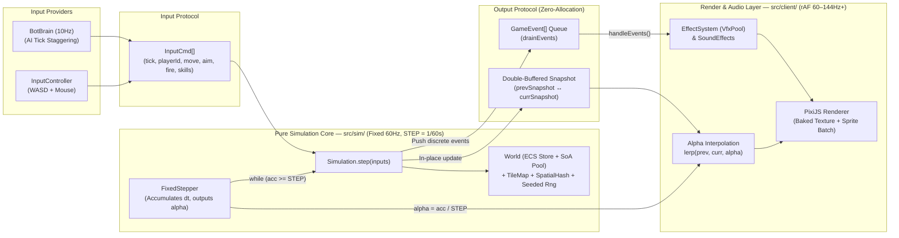
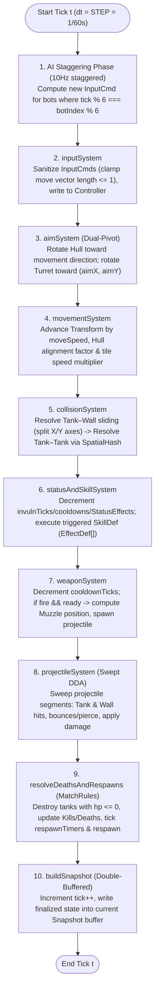

# System Architecture

This document specifies the high-level architecture of **Tanks of Arena**: the unidirectional data flow between Client and Simulation, the canonical directory structure, the fixed per-tick System execution pipeline (`60 Hz`), and the three core performance optimizations.

---

## 1. Unidirectional Data Flow

The architecture strictly decouples the **Simulation Core (`src/sim/`)** from the **Presentation & Input Layer (`src/client/`)** across a pure data protocol boundary (`src/shared/protocol.ts`). All state mutations happen exclusively inside `Simulation.step(inputs)`.



### Data Flow Invariants
1. **Uniform Input Contract:** Local players, AI bots, and remote network players (Milestone M7) all drive the simulation through the identical `InputCmd` structure.
2. **Continuous State via `Snapshot`:** Entity positions, `Hull`/`Turret` angles, hitpoints, weapon reload progress, and bush concealment (`inBush`) are exposed solely through `Snapshot`.
3. **Discrete Occurrences via `GameEvent`:** One-shot events (`ProjectileFired`, `ProjectileHit`, `TankDestroyed`, `TileDamaged`, `TileChanged`) are drained each tick via `sim.drainEvents()` to trigger VFX particles and audio without polluting `src/sim/`.
4. **Strict Determinism:** Given identical `SimConfig` (including `seed`), `GameContent`, and per-tick `InputCmd[]` streams, `Simulation` produces bit-identical `Snapshot`s and `GameEvent[]` sequences across Browser and Node.js runtimes.

---

## 2. Directory Layout

```text
tank_of_arena/
├─ AGENTS.md                        # Iron rules, verification commands & context pointers for AI Agents
├─ GLOSSARY.md                      # Ubiquitous domain language & canonical TypeScript type names
├─ index.html                       # Browser application entry HTML
├─ package.json  tsconfig.json  vite.config.ts
├─ data/                            # STATIC CONTENT (Data-Driven JSON) — Zero logic
│  ├─ index.ts                      # Loads and validates all JSON content at startup
│  ├─ tiles.json                    # Terrain definitions (floor, steel, brick, bush...)
│  ├─ tanks/        *.json          # Tank archetypes (TankDef: striker, ghost...)
│  ├─ skills/       *.json          # Skill definitions (SkillDef + EffectDef[] chains)
│  ├─ projectiles/  *.json          # Projectile archetypes (ProjectileDef)
│  └─ maps/         *.json          # ASCII grid layouts + team spawn points (MapDef)
├─ docs/                            # AI-First technical specifications
│  ├─ 00-overview/
│  │  └─ architecture.md            # (This file) Data flow, directory structure, system execution order
│  ├─ 01-adr/                       # Architecture Decision Records (Context -> Decision -> Rules)
│  │  ├─ 001-deterministic-sim.md
│  │  ├─ 002-world-space-dual-pivot.md
│  │  ├─ 003-zero-gc-memory-model.md
│  │  ├─ 004-swept-dda-collision.md
│  │  ├─ 005-composable-effect-registry.md
│  │  ├─ 006-staggered-ai-input-provider.md
│  │  └─ 007-authoritative-visibility-and-stealth.md
│  ├─ 02-specs/                     # Detailed subsystem specifications
│  │  ├─ 01-ecs-and-physics.md      # World, Components, Dual-Pivot, sliding collisions & DDA raycast
│  │  ├─ 02-data-driven-and-effects.md # Data schemas, EFFECT_REGISTRY & content validation rules
│  │  ├─ 03-rendering-and-vfx.md    # Alpha interpolation, generateTexture baking, Layering, VfxPool
│  │  ├─ 04-ai-bot-brain.md         # A* Pathfinding, tactical FSM, CPA dodging, AI Tick Staggering
│  │  └─ 05-match-lifecycle-and-network.md # Spawning, MatchState, Replay format & Transport/Prediction
│  └─ 03-tickets/                   # Tracer-Bullet vertical slice tickets (T01 → T30) with DAG & DoD
│     ├─ 00-index.md                # Master dependency graph (DAG) & active frontier
│     └─ m1..m7-*.md                # Per-milestone vertical slice tickets & acceptance criteria
├─ src/
│  ├─ shared/                       # SHARED CLIENT & SIM (Pure TS, environment-agnostic)
│  │  ├─ constants.ts               # TICK_RATE (60), STEP (1/60), RESPAWN_TICKS, SKILL bitmasks
│  │  ├─ FixedStepper.ts            # Fixed-timestep accumulator + spiral-of-death clamp
│  │  ├─ rng.ts                     # Seeded deterministic PRNG (Mulberry32)
│  │  ├─ protocol.ts                # InputCmd, Snapshot, TankSnapshot, ProjectileSnapshot, GameEvent
│  │  ├─ math/                      # vec2.ts, angle.ts (wrap, angleDiff, turnToward), segment.ts
│  │  └─ schema/                    # types.ts & validate.ts (JSON schema integrity checks)
│  ├─ sim/                          # PURE SIMULATION CORE (No DOM, PixiJS, Math.random, Date.now)
│  │  ├─ Simulation.ts              # Tick orchestrator, player lifecycle, Snapshot/Event emission
│  │  ├─ World.ts                   # Entity registry (EntityId) + ComponentStore + ProjectilePool (SoA)
│  │  ├─ snapshot.ts                # Builds/updates Double-Buffered Snapshot from World state
│  │  ├─ components/                # Transform, Hull, Turret, Mobility, Controller, Health, Weapon...
│  │  ├─ entities/                  # spawnTank.ts (assembles tank entity components from TankDef)
│  │  ├─ combat/                    # combat.ts (armor damage reduction, tile damage, event emission)
│  │  ├─ effects/                   # EFFECT_REGISTRY & atomic handlers: spawnProjectile, dash, shield...
│  │  ├─ map/                       # TileMap.ts, collision.ts (Circle-AABB), raycast.ts (swept DDA)
│  │  ├─ spatial/                   # SpatialHash.ts (O(1) uniform grid for Tank-Tank & Projectile-Tank)
│  │  ├─ systems/                   # Deterministic per-tick Systems executed in fixed order
│  │  └─ ai/                        # BotBrain.ts, Pathfinder.ts (A*), ThreatDodge.ts (CPA)
│  ├─ client/                       # BROWSER PRESENTATION & INPUT LAYER (PixiJS + DOM + WebAudio)
│  │  ├─ main.ts                    # Bootstraps application, wires GameLoop across Input, Sim & Renderer
│  │  ├─ GameLoop.ts                # requestAnimationFrame loop driving FixedStepper + render(alpha)
│  │  ├─ input/                     # InputController.ts (Keyboard/Mouse -> world-space InputCmd)
│  │  ├─ render/                    # Renderer.ts, Camera.ts, SpriteFactory.ts, Effects.ts (VfxPool)
│  │  ├─ audio/                     # SoundEffects.ts (procedural Web Audio synthesizer)
│  │  └─ ui/                        # HudOverlay.ts, DebugOverlay.ts (toggled via F3)
│  ├─ net/                          # (M7) LocalTransport / WebSocketTransport abstractions
│  └─ server/                       # (M7) Authoritative Node.js server running src/sim/ directly
└─ tests/                           # Headless Vitest test suite
   ├─ sim-purity.test.ts            # Guardrail test enforcing zero forbidden imports in src/sim & src/shared
   └─ *.test.ts                     # Unit & property tests for angle math, collisions, combat, data, sim
```

---

## 3. Fixed Per-Tick System Execution Order (60Hz Pipeline)

Whenever `FixedStepper` accumulates `STEP = 1 / 60` second, `Simulation.step(inputs)` executes the following 10 stages in **strict, invariant order**. Reordering any stage breaks determinism or introduces one-tick latency bugs.



### Stage Responsibilities & Ordering Rationale

| Order | Stage / System | Primary Inputs | Outputs / Side Effects | Ordering Rationale |
| :---: | :--- | :--- | :--- | :--- |
| **1** | **AI Staggering** (`botBrain`) | Previous `Snapshot`, `TileMap`, `tick` | Appends bot `InputCmd`s to the tick input list | Bots must submit their commands before `inputSystem` ingests all player inputs for tick $t$. |
| **2** | **`inputSystem`** | `Map<playerId, InputCmd>` | Mutates `Controller` component | Clamps `(moveX, moveY)` magnitude to $\le 1$ so diagonal movement never exceeds cardinal speed. |
| **3** | **`aimSystem`** | `Controller`, `Transform`, `Hull`, `Turret` | Updates `hull.angle` and `turret.angle` | Rotates `Hull` and `Turret` before movement and firing so hull alignment (`align`) and barrel angle take effect on the current tick. |
| **4** | **`movementSystem`** | `Controller`, `Hull`, `Mobility`, `TileMap` | Advances candidate `Transform (x, y)` | Moves tanks along their intended velocity scaled by terrain `moveSpeedMul` and hull alignment factor. |
| **5** | **`collisionSystem`** | `Transform`, `Mobility`, `TileMap`, `SpatialHash` | Clamps valid `Transform (x, y)`, rebuilds `SpatialHash` | Resolves Circle–AABB wall sliding and Circle–Circle tank separation immediately after movement, leaving an accurate `SpatialHash` for combat. |
| **6** | **`statusAndSkillSystem`** | `Health`, `Controller.skills`, `StatusEffects` | Ticks active timers, dispatches `EffectDef[]` | Processes spawn protection (`invulnTicks`), shields, stealth, and dashes after base movement is resolved and before weapon fire. |
| **7** | **`weaponSystem`** | `Controller`, `Transform`, `Turret`, `Weapon`, `Rng` | Spawns projectiles, emits `ProjectileFired` | Computes world-space muzzle coordinates (`muzzleOffset` rotated by `turret.angle`) from the post-collision tank position. |
| **8** | **`projectileSystem`** | `Projectile` (SoA Pool), `TileMap`, `SpatialHash` | Sweeps rays, applies damage, emits `ProjectileHit` / `TankDamaged` / `TileDamaged` | Projectiles spawned in Stage 7 or already in flight sweep across the latest post-collision tank positions and tile grid. |
| **9** | **`resolveDeathsAndRespawns`** | `PlayerState`, `Health`, `TileMap` | Destroys dead entities, increments `kills`/`deaths`, respawns tanks, emits `TankDestroyed` / `TankSpawned` | Aggregates all damage from projectiles and skills at the end of the tick so entities are never deleted mid-iteration. |
| **10** | **`buildSnapshot`** | `World`, `TileMap`, `PlayerState`, `tick` | Updates `Snapshot` for `tick + 1` | Guarantees that `Renderer` always observes a complete, post-collision, post-damage world snapshot. |

---

## 4. Three Core Performance Optimizations

To sustain **60+ FPS with hundreds of active projectiles and VFX particles** in the browser without Garbage Collector pauses or CPU/GPU bottlenecks, the architecture enforces three structural optimizations:

### 4.1 Double-Buffered Snapshot (Zero-Allocation State Handoff)
- **Problem:** Allocating fresh `tanks: []` and `projectiles: []` arrays populated with hundreds of `{ id, x, y, ... }` objects 60 times per second—and copying them into `prevById` maps on the client—creates continuous heap churn and GC frame spikes.
- **Solution:**
  - Maintain two pre-allocated `Snapshot` buffers (`prevSnapshot` and `currSnapshot`) with reusable element slots.
  - At each simulation tick boundary, swap the buffer references and overwrite primitive fields (`x`, `y`, `hullAngle`, `turretAngle`, `hp`, `reload`) in-place, adjusting only the active logical count.
  - `Renderer` interpolates directly between `prevSnapshot` and `currSnapshot` using `alpha`:
    $$\text{pos}_{\text{render}} = \text{pos}_{\text{prev}} + (\text{pos}_{\text{curr}} - \text{pos}_{\text{prev}}) \times \alpha$$
    $$\theta_{\text{render}} = \text{wrap}\!\left(\theta_{\text{prev}} + \text{angleDiff}(\theta_{\text{prev}}, \theta_{\text{curr}}) \times \alpha\right)$$

### 4.2 PIXI `generateTexture` & Sprite Batching (GPU Draw-Call Elimination)
- **Problem:** Calling `PIXI.Graphics.clear()`, `.rect()`, `.circle()`, and `.stroke()` every frame for hundreds of projectiles, tanks, and particles forces CPU path tessellation and GPU vertex buffer re-uploads on every render frame.
- **Solution:**
  - During `SpriteFactory` / `Renderer` initialization, draw procedural shapes for each `Hull`, `Turret`, `Projectile`, and particle archetype into a temporary `PIXI.Graphics` instance **once**, bake it into a GPU texture via `app.renderer.generateTexture(graphics)`, cache the `PIXI.Texture`, and destroy the temporary `Graphics`.
  - Inside `draw()`, represent every tank part, projectile, and particle as a lightweight `PIXI.Sprite` sharing the cached `Baked Texture`. PixiJS automatically batches hundreds of sprites into a single WebGL/WebGPU draw call while updating only `position`, `rotation`, `scale`, `alpha`, and `tint`.

### 4.3 AI Tick Staggering & SoA Pools (CPU Budget Smoothing)
- **Problem:** Running A* grid pathfinding and projectile threat scanning for all AI bots on the same tick causes periodic CPU spikes every 100ms. Similarly, allocating class instances per bullet fragments memory.
- **Solution:**
  - **AI Tick Staggering (10Hz Phase-Shifted):** Partition bot updates across a 6-tick window (`AI_PERIOD = 6` ticks = `100 ms`). On tick $t$, only bots satisfying `botIndex % 6 === t % 6` run `BotBrain.computeInput()` (A* pathfinding, target selection, CPA threat dodging). For the remaining 5 ticks, bots emit their cached `InputCmd`.
  - **SoA Pools (`ProjectilePool` & `VfxPool`):** Store projectiles and VFX particles in flat, fixed-capacity typed arrays (`Float32Array` for `x, y, dirX, dirY, speed, remaining`; `Uint16Array` for `generation, ownerId, team, bounces`) managed by a `free-list`, ensuring contiguous CPU cache locality and zero heap allocation.
