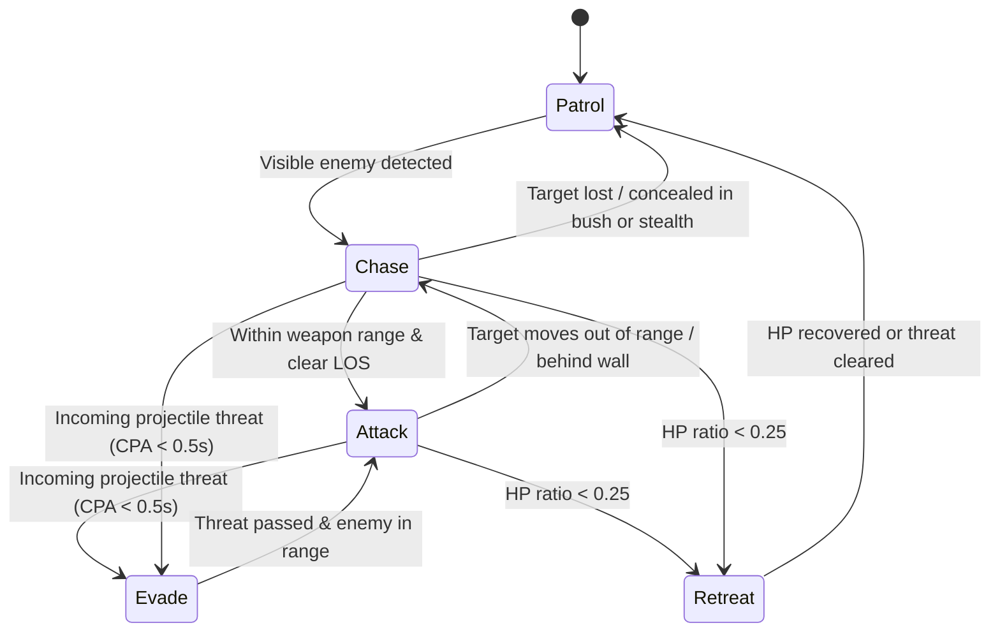

# Specification 04: AI Bot Brain, Pathfinding, CPA Dodging, and Tick Staggering (`src/sim/ai/`)

This specification defines the AI bot architecture in `src/sim/ai/`, including 10Hz phase-shifted tick staggering, A* grid pathfinding with line-of-sight string pulling, the tactical Finite State Machine (FSM), Closest Point of Approach (CPA) projectile dodging, and first-order target leading.

---

## 1. AI Architecture & 10Hz Tick Staggering

1. **Pure `InputCmd` Producer:** Each bot is controlled by a `BotBrain` instance associated with a `playerId`. `BotBrain` never mutates `World` directly; it produces a standard `InputCmd` consumed by `Simulation.step(inputs)`.
2. **Phase-Shifted 10Hz Schedule (`AI_PERIOD = 6`):**
   - At `60 Hz`, running A* pathfinding and threat scanning every tick is unnecessary and expensive.
   - Bot $i$ (`botIndex` $\in \{0, 1, \dots, N-1\}$) recomputes its decision **only** on ticks where:
     $$\text{tick} \bmod 6 === \text{botIndex} \bmod 6$$
   - On the remaining 5 ticks of each 6-tick window (`100 ms`), the bot re-emits its cached `InputCmd` (with `cmd.tick` updated to the current tick).

---

## 2. Tactical Finite State Machine (FSM)

On each decision tick, `BotBrain` evaluates visible enemy tanks (filtered through `isTankVisibleToTeam` per [ADR 007](../01-adr/007-authoritative-visibility-and-stealth.md)) and transitions between 5 tactical states:

| State | Entry Condition | Movement Behavior (`moveX, moveY`) | Aim & Combat (`aimX, aimY, fire, skills`) |
| :--- | :--- | :--- | :--- |
| **`Patrol`** | No visible enemy tank | Follow A* path toward central arena waypoints or bush cover | Sweep turret along movement heading; `fire = false` |
| **`Chase`** | Enemy visible, distance $> 0.8 \times \text{range}$ or blocked by wall | Follow smoothed A* path toward target's position | Aim at target lead position; `fire` if clear line-of-sight |
| **`Attack`** | Enemy visible, within effective range, clear line-of-sight | Strafe perpendicular to target vector while maintaining optimal range | Aim at target lead position; `fire = true`; trigger offensive skills (`Q`/`E`) |
| **`Evade`** | Incoming projectile will hit within $t_{\text{cpa}} \in (0, 0.5\text{s}]$ | Move perpendicular to projectile velocity (or trigger `dash` / `shield` skill) | Keep turret locked on nearest visible enemy; `fire` if aligned |
| **`Retreat`** | Bot `hp / maxHp < 0.25` | Pathfind toward nearest allied spawn or concealing `bush` tile | Aim and fire backward at pursuing enemy (`Dual-Pivot` advantage) |

---

## 3. A* Grid Pathfinding & String Pulling (`Pathfinder.ts`)

1. **Grid Graph & Tile Traversal Costs:**
   - Nodes correspond to tile centers `(col + 0.5, row + 0.5)`.
   - 8-way connectivity (4 cardinal neighbors at base cost $1.0$, 4 diagonal neighbors at base cost $\sqrt{2} \approx 1.414$).
   - **Corner-Cutting Prevention:** Diagonal step `(col + dc, row + dr)` is allowed **only** if both adjacent cardinal tiles `(col + dc, row)` and `(col, row + dr)` are passable.
   - **Terrain Cost Weights:**
     - Indestructible wall (`blocksMove && hp === undefined`): **Impassable** ($\infty$).
     - Destructible brick (`blocksMove && hp !== undefined`): Passable only if no open path exists, with high penalty cost $C_{\text{brick}} = 8.0 + 2.0 \times \text{tileHp}$ (bot shoots the blocking brick while approaching).
     - Passable tile (`!blocksMove`): Cost $= 1.0 / (\text{moveSpeedMul} ?? 1.0)$, with a slight preference bonus ($0.85$) for `bush` tiles during `Retreat` or `Patrol`.
2. **Heuristic:** Octile distance to goal tile.
3. **Line-of-Sight String Pulling (Path Smoothing):**
   - After A* returns a tile chain $[P_0, P_1, \dots, P_k]$, greedily remove intermediate waypoint $P_{i}$ whenever a clearance check from $P_{i-1}$ to $P_{i+1}$ (inflated by tank `radius`) hits no blocking tiles.

---

## 4. Projectile Dodging via Closest Point of Approach (`CPA`)

Before committing to its FSM movement vector, `BotBrain` scans active enemy projectiles within `6.0` world units:

1. Let bot center be $\mathbf{B} = (x_b, y_b)$ and projectile state be position $\mathbf{P}_0 = (x_p, y_p)$ with velocity $\mathbf{v}_p = (\text{dirX}\cdot s_p,\; \text{dirY}\cdot s_p)$.
2. Compute time to Closest Point of Approach clamped to horizon $T_{\max} = 0.5\text{s}$:
   $$t_{\text{cpa}} = \operatorname{clamp}\!\left(\frac{(\mathbf{B} - \mathbf{P}_0) \cdot \mathbf{v}_p}{\|\mathbf{v}_p\|^2},\; 0,\; 0.5\right)$$
3. Compute the closest point $\mathbf{C} = \mathbf{P}_0 + t_{\text{cpa}}\mathbf{v}_p$ and separation vector $\mathbf{d} = \mathbf{B} - \mathbf{C}$.
4. If $\|\mathbf{d}\| < r_{\text{bot}} + r_{\text{proj}} + 0.25$:
   - Compute the two unit vectors perpendicular to $\mathbf{v}_p$: $\mathbf{n}_1 = (-\text{dirY}, \text{dirX})$ and $\mathbf{n}_2 = (\text{dirY}, -\text{dirX})$.
   - Pick the normal $\mathbf{n}^*$ that points away from the projectile line ($\mathbf{n}^* \cdot \mathbf{d} \ge 0$) and does not immediately collide with a wall tile (`!map.blocksMove(...)`).
   - Override `(moveX, moveY)` with $\mathbf{n}^*$ (and trigger `dash` or `shield` skill if available and danger is imminent).

---

## 5. Target Leading & Difficulty Profiles

To aim at a moving target at $\mathbf{T} = (x_t, y_t)$ with estimated velocity $\mathbf{v}_t = (v_{tx}, v_{ty})$ using a weapon with projectile speed $s_p$:

1. **First-Order Lead Time:**
   $$t_{\text{lead}} = \frac{\|\mathbf{T} - \mathbf{B}\|}{s_p}$$
2. **Predicted Impact Point + Seeded Jitter:**
   $$\mathbf{Aim}_{\text{ideal}} = \mathbf{T} + \mathbf{v}_t \cdot t_{\text{lead}}$$
   $$\theta_{\text{aim}} = \operatorname{atan2}(Aim_y - y_b,\; Aim_x - x_b) + \text{rng.range}(-\sigma_{\text{diff}},\, +\sigma_{\text{diff}})$$
   where $\sigma_{\text{diff}}$ is the difficulty angular error in radians (`Easy: 0.22 rad`, `Normal: 0.10 rad`, `Hard: 0.02 rad`), drawn strictly from the `Simulation`'s seeded `Rng`.
3. **Fire Discipline:** Set `fire = true` only when:
   - $|\text{angleDiff}(\theta_{\text{turret}}, \theta_{\text{aim}})| < 0.18\text{ rad}$, **and**
   - `raycastTiles(map, x_b, y_b, Aim_x, Aim_y)` is either unobstructed or hits a destructible brick tile directly in front of the target.
