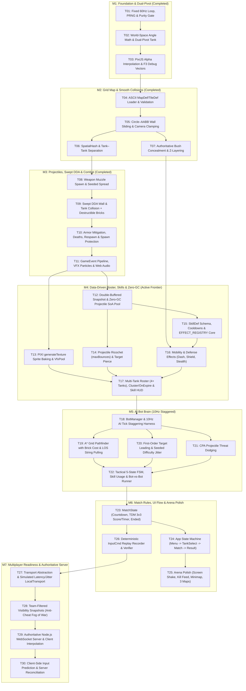

# Tracer-Bullet Tickets — Master Index & Dependency Graph (M1–M7)

This directory breaks the **Tanks of Arena** roadmap (Milestones M1 through M7) into **30 independent Tracer-Bullet Tickets (`T01`–`T30`)**.

Each ticket represents a **vertical slice** that cuts across schema/data (`data/`, `src/shared/`), deterministic simulation (`src/sim/`), presentation/input (`src/client/`), and automated headless verification (`tests/`).

---

## 1. Execution Rules for AI Agents

1. **Work the Frontier Only:** An agent may only start a ticket whose `Blocked by` dependencies are all `completed`.
2. **One Ticket = One Verifiable Vertical Slice:** Never mix unrelated tickets in a single change. Every ticket must leave `npm test`, `npm run typecheck`, and `npm run build` completely green.
3. **Obey ADRs & Glossary:** All identifiers and designs must strictly adhere to [`GLOSSARY.md`](../../GLOSSARY.md) and [`docs/01-adr/`](../01-adr/).

---

## 2. Dependency Graph (DAG)

---

## 3. Milestone Ticket Files

| File | Milestone | Tickets | Current Status |
| :--- | :---: | :---: | :--- |
| [`m1-foundation-and-dual-pivot.md`](./m1-foundation-and-dual-pivot.md) | **M1** | `T01` – `T03` | `completed` |
| [`m2-grid-map-and-collisions.md`](./m2-grid-map-and-collisions.md) | **M2** | `T04` – `T07` | `completed` |
| [`m3-projectiles-and-combat.md`](./m3-projectiles-and-combat.md) | **M3** | `T08` – `T11` | `completed` |
| [`m4-data-driven-skills-and-zero-gc.md`](./m4-data-driven-skills-and-zero-gc.md) | **M4** | `T12` – `T17` | **`ready-for-agent` (Frontier: `T12`, `T13`)** |
| [`m5-ai-bot-brain.md`](./m5-ai-bot-brain.md) | **M5** | `T18` – `T22` | `blocked` (by M4) |
| [`m6-match-rules-and-ui-polish.md`](./m6-match-rules-and-ui-polish.md) | **M6** | `T23` – `T26` | `blocked` (by M5) |
| [`m7-multiplayer-and-transport.md`](./m7-multiplayer-and-transport.md) | **M7** | `T27` – `T30` | `blocked` (by M6) |
